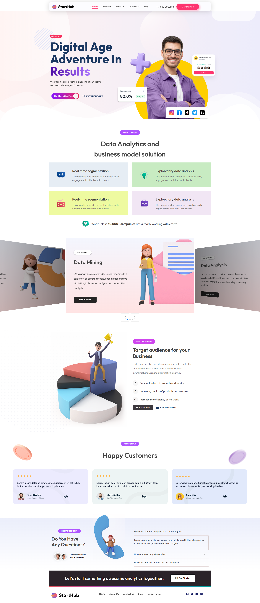
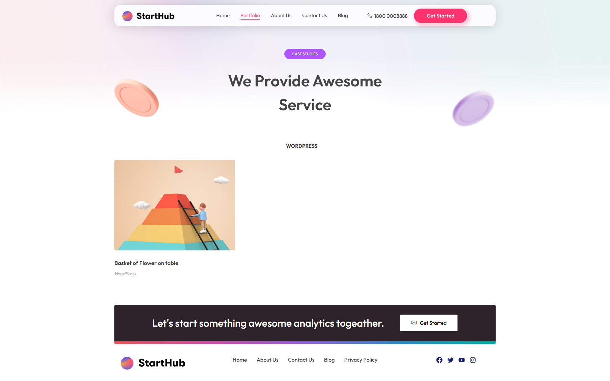
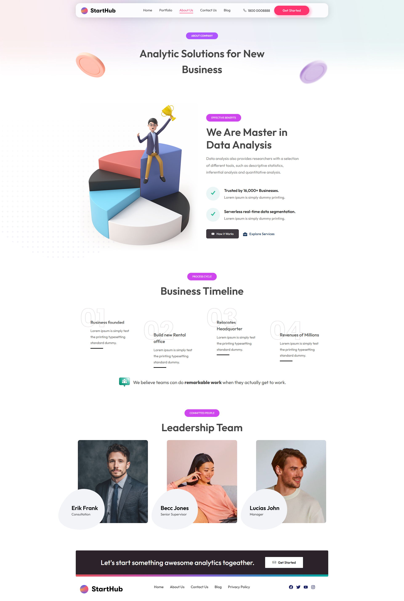
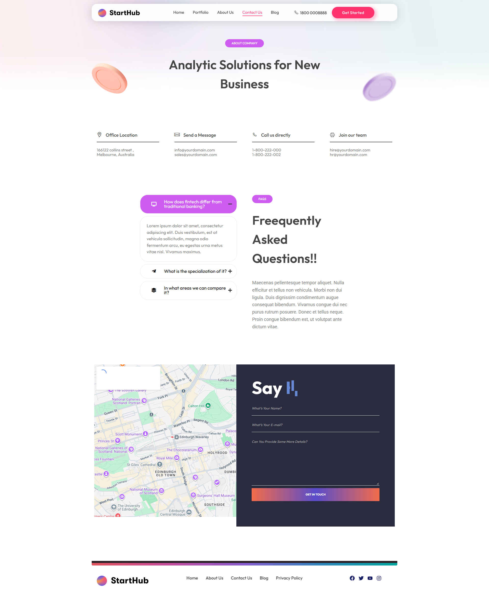
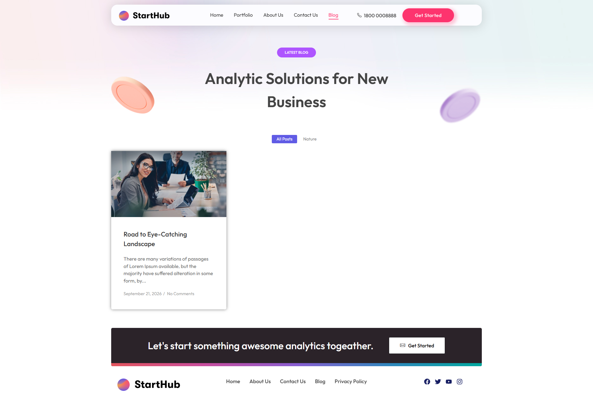
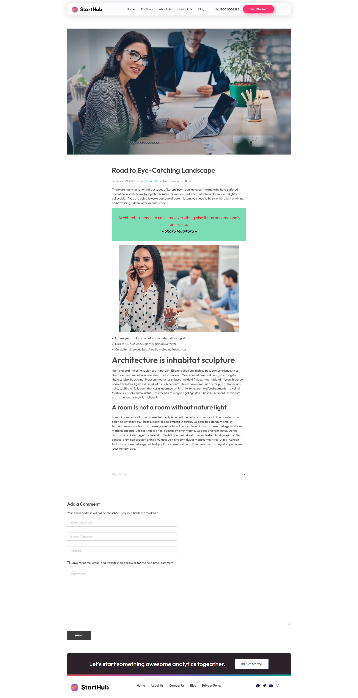

# StartHub – Data Analytics Agency Website

StartHub is a modern, multi-page website for a data analytics and business solutions company. Built with WordPress and the Phlox theme, it presents services, case studies, customer testimonials, frequently asked questions and contact options in a clean, colorful interface with 3D-style illustrations.

## Homepage



## Portfolio Page



## About Page



## Contact Page



## Blog Page



## Blog Post Page



---

## Table of Contents

1. [Overview](#overview)
2. [Features](#features)
3. [Pages and Structure](#pages-and-structure)
4. [Technologies Used](#technologies-used)
5. [Skills Demonstrated](#skills-demonstrated)
6. [Design System](#design-system)
7. [Screenshots](#screenshots)
8. [Repository Structure](#repository-structure)
9. [Installation](#installation)
10. [Customization](#customization)
11. [Key Learnings](#key-learnings)
12. [Author](#author)


---

## Overview

This project is a business website for an analytics and consulting company. It is designed to explain data services clearly, build trust through social proof and guide visitors toward getting in touch.

**Project objectives**

- Present analytics services and benefits in a clear, approachable way
- Build credibility with testimonials, statistics and case studies
- Provide multiple paths for contact, including a form, phone, email and map
- Apply a cohesive visual style with soft gradients, pastel cards and 3D illustrations

---

## Features

- Floating navigation bar with phone number and "Get Started" button
- Hero section with headline, call-to-action buttons and an engagement statistics card
- Social media icon row (Instagram, Facebook, TikTok, Twitter and Behance)
- Colored feature cards describing analytics capabilities
- Services slider with navigation arrows and pagination dots
- Benefits section with a checklist of business advantages
- Testimonial cards with star ratings, client names and job titles
- Accordion-style FAQ sections on the home and contact pages
- Portfolio page with category label and project cards
- Contact page with office details, embedded map and message form
- Full-width call-to-action banner and a consistent footer across all pages

---

## Pages and Structure

### Home

| Section | Description |
|---|---|
| Header | Logo, navigation (Home, Portfolio, About Us, Contact Us, Blog), phone number and "Get Started" button |
| Hero | Headline "Digital Age Adventure In Results", supporting text, "Get Started for Free" button, email link and a profile image with an engagement card |
| About Company | "Data Analytics and business model solution" with four color-coded cards such as Real-time segmentation and Exploratory data analysis |
| Services Slider | Carousel highlighting services such as Data Mining and Data Analysis, each with a "How It Works" button |
| Effective Benefits | "Target audience for your Business" with a three-point checklist and two action buttons |
| Testimonials | "Happy Customers" with three review cards |
| FAQ | "Do You Have Any Questions?" with an expandable question list and support team indicator |
| Call to Action | Dark banner with a "Get Started" button |
| Footer | Logo, quick links (Home, About Us, Contact Us, Blog, Privacy Policy) and social media icons |

### Portfolio

| Section | Description |
|---|---|
| Page Header | "Case Studies" label with the heading "We Provide Awesome Service" |
| Category Filter | WordPress category label |
| Project Grid | Project card with image, title and category |

### Contact Us

| Section | Description |
|---|---|
| Page Header | "Analytic Solutions for New Business" |
| Contact Details | Four columns: Office Location, Send a Message, Call us directly and Join our team |
| FAQ | "Frequently Asked Questions" with an expandable accordion |
| Map and Form | Embedded map beside a "Say Hi" message form with name, email and details fields |

---

## Technologies Used

| Technology | Purpose |
|---|---|
| WordPress | Content management system |
| Phlox Theme | Base theme providing layouts, typography and design options |
| Elementor | Visual page builder for custom sections |
| HTML5 and CSS3 | Structure and custom styling |
| Google Maps Embed | Office location map on the Contact page |
| Git and GitHub | Version control and project documentation |

Update this table to match the plugins and tools you actually used.

---

## Skills Demonstrated

| Skill | How It Was Applied |
|---|---|
| WordPress Development | Setting up a multi-page site with menus, pages and portfolio items |
| Theme Customization | Configuring the Phlox theme for branding, typography and layout |
| Page Building | Creating hero, services, benefits, testimonial and FAQ sections |
| UI/UX Design | Clear hierarchy, color-coded cards and prominent calls to action |
| Interactive Components | Services carousel, FAQ accordions and a contact form |
| Responsive Design | Layouts that adapt to desktop, tablet and mobile screens |
| Content Structuring | Logical page flow from introduction to proof to contact |
| Third-Party Integration | Embedding a map and linking social media profiles |
| Version Control | Managing project files and documentation with Git and GitHub |

---

## Design System

### Color Palette

| Role | Color (approximate) |
|---|---|
| Primary accent | Coral pink `#FF3366` |
| Secondary accent | Violet `#A855F7` |
| Highlight | Golden yellow `#FFC700` |
| Dark surface | Charcoal `#2A2330` |
| Card tints | Soft blue, mint green, lime and lavender |

### Typography

- **Font:** Modern geometric sans-serif (Outfit-style)
- **Headings:** Medium to semi-bold weight, large size
- **Body text:** Regular weight in a muted gray for readability

### Interface Elements

- Floating, rounded navigation bar
- Pill-shaped buttons and section labels
- Soft pastel gradient backgrounds
- 3D illustrations and floating coin shapes as decoration
- Gradient accent line above the footer

---

## Repository Structure

```
starthub/
├── screenshots/
│   ├── starthub-home.png
│   ├── starthub-portfolio.png
│   └── starthub-contact.png
└── README.md
```

Update this structure to reflect the actual contents of the repository.

---

## Installation

### Prerequisites

- PHP 7.4 or higher
- MySQL 5.7 or higher (or MariaDB equivalent)
- A local server environment such as LocalWP, XAMPP, WAMP or MAMP

### Steps

1. Clone the repository:
   ```bash
   git clone https://github.com/Aqsa-javed8822/starthub.git
   ```
2. Place the project in your server's web root (`htdocs` or `www`).
3. Create a new database and import the SQL file, if one is provided.
4. Update `wp-config.php` with your database name, username and password.
5. Open the site in your browser and log in at `/wp-admin`.
6. Install and activate the Phlox theme and the required plugins, including Elementor.

---

## Customization

- **Branding:** Update the logo, colors and fonts from the theme customizer
- **Content:** Edit headlines, service cards, testimonials and FAQ entries
- **Portfolio:** Add new case studies from the WordPress dashboard
- **Contact details:** Replace the placeholder address, phone numbers, emails and map location
- **Navigation:** Manage header and footer links from Appearance > Menus

---

## Key Learnings

- Building a multi-page business website with WordPress and a premium theme
- Customizing a theme to create a consistent visual identity
- Designing interactive elements such as sliders and accordions
- Structuring content to build trust and encourage contact
- Documenting a project professionally on GitHub

---

## Author

**Aqsa Javed**

- GitHub: [@Aqsa-javed8822](https://github.com/Aqsa-javed8822)

---


